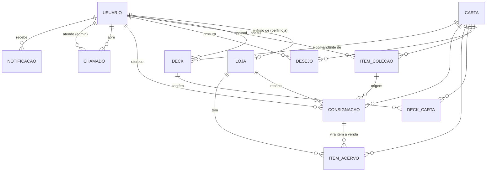

# Modelagem de dados

Implementada em `backend/src/models/` (Sequelize). PostgreSQL em produção, SQLite em desenvolvimento e testes. Cartas não são copiadas do Scryfall inteiras: guardamos só o necessário e o `scryfall_id`.



| Tabela | Campos principais |
|---|---|
| **usuarios** | id, nome, email (único), senha_hash, perfil (`usuario` \| `loja` \| `admin`), ativo |
| **lojas** | id, usuario_id (único → 1:1), nome, descricao, endereco, cidade, uf, latitude, longitude, horario, telefone, aceita_consignacao, aprovada |
| **cartas** | id, scryfall_id (único), oracle_id, nome, edicao, codigo_edicao, numero_colecionador, tipo, custo_mana, cmc, identidade_cor (`WUBRG`), raridade, imagem_url, preco_usd, legalidades (JSON por formato, do Scryfall) |
| **itens_colecao** | id, usuario_id, carta_id, quantidade, condicao (`NM`/`SP`/`MP`/`HP`/`D`), foil, observacao — único por (usuário, carta, condição, foil) |
| **desejos** | id, usuario_id, carta_id, prioridade (`baixa` | `media` | `alta`), preco_maximo_usd, observacao — único por (usuário, carta) |
| **decks** | id, usuario_id, nome, formato (`commander`, `pauper`, `standard`, `pioneer`, `modern`, `legacy`, `vintage`, `casual`), descricao, comandante_id → carta (só Commander; não entra em deck_cartas) |
| **deck_cartas** | deck_id + carta_id (chave composta), quantidade |
| **itens_acervo** | id, loja_id, carta_id, quantidade, condicao, foil, preco (R$), consignacao_id (opcional) |
| **consignacoes** | id, usuario_id, loja_id, carta_id, item_colecao_id, quantidade, condicao, foil, preco_pedido, preco_venda, status, observacao, resposta_loja, respondida_em, encerrada_em |
| **chamados** | id, usuario_id, atendente_id (admin), assunto, mensagem, status (`aberto` \| `em_atendimento` \| `resolvido`), resposta |
| **notificacoes** | id, usuario_id, tipo (`consignacao` \| `chamado` \| `sistema`), titulo, mensagem, referencia_id, lida |

Todas as tabelas têm `created_at` e `updated_at`.

## Relacionamentos exigidos em Web 2
- **N:N (4):** Deck ↔ Carta (`deck_cartas`), Usuário ↔ Carta (`itens_colecao` e `desejos`), Loja ↔ Carta (`itens_acervo`).
- **1:N (mais de 3):** Usuário → Deck, ItemColecao, Desejo, Consignação, Chamado, Notificação; Loja → ItemAcervo, Consignação.
- **1:1:** Usuário (perfil loja) → Loja.

## Fluxo da consignação

```
pendente ──► aceita ──► a_venda ──► vendida
   │           │           └──────► devolvida
   │           └──────────────────► devolvida
   ├──► recusada   (loja recusou)
   └──► cancelada  (usuário desistiu antes da resposta)
```

Transições fora deste fluxo são rejeitadas pelo próprio model. Cada mudança gera uma notificação para o usuário.

## Exclusão
- Carta em uso (coleção, desejos, deck, acervo, consignação) não pode ser apagada.
- Apagar usuário apaga sua loja, decks, coleção, desejos, consignações, chamados e notificações.
- Apagar um item da coleção não apaga a consignação: `item_colecao_id` fica nulo e o histórico continua.

## Decisões tomadas (podem ser revistas pela equipe)
1. **Loja tem um único dono** (usuário com perfil `loja`).
2. **Consignação não vira item do acervo automaticamente.** Quando a loja coloca à venda, cria um `item_acervo` com `consignacao_id`; essa regra fica no controller.
3. **Chamado de suporte entra**, pois dá função ao perfil admin (RF09).
4. **Lista de desejos entrou** como N:N Usuário ↔ Carta (`desejos`), com prioridade e preço máximo em US$ (comparado com o preço de referência do Scryfall).
5. **Notificações** viraram tabela própria (RF10), preenchida por hooks.
6. **Decks em vários formatos.** As regras (tamanho, cópias, legalidade, identidade de cor) são verificadas pelo backend e mostradas como avisos, sem impedir a edição. A avaliação por ML continua só para Commander (é o que o modelo do TP aprendeu).
7. **Tabelas criadas com `sync()`** em vez de migrações, para simplificar. Trocar por migrações se o schema precisar evoluir com dados em produção.
