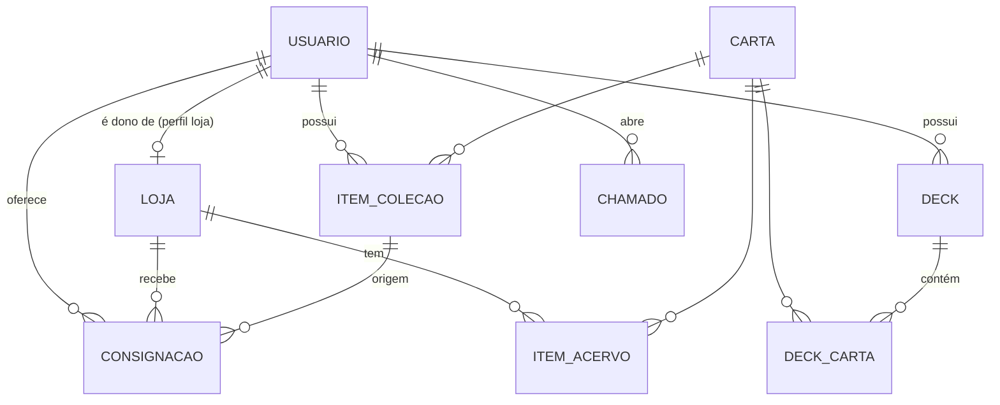

# Modelagem de dados — PROPOSTA (a confirmar com a equipe)

Banco relacional (PostgreSQL). Cartas não são copiadas do Scryfall inteiras: guardamos só o necessário e o `scryfall_id`.

| Tabela | Campos principais |
|---|---|
| **usuario** | id, nome, email, senha_hash, perfil (`usuario` \| `loja` \| `admin`), ativo |
| **loja** | id, usuario_id (dono, 1:1), nome, endereço, latitude, longitude, horário, aprovada |
| **carta** | id, scryfall_id, oracle_id, nome, edição, imagem_url, identidade_cor |
| **item_colecao** | id, usuario_id, carta_id, quantidade, condição (NM/SP/MP/HP), foil |
| **deck** | id, usuario_id, nome, comandante_id → carta |
| **deck_carta** | deck_id, carta_id, quantidade |
| **item_acervo** | id, loja_id, carta_id, quantidade, preço, condição |
| **consignacao** | id, usuario_id, loja_id, item_colecao_id, preço_pedido, status (`pendente` → `aceita`/`recusada` → `à venda` → `vendida`/`devolvida`), datas |
| **chamado** | id, usuario_id, assunto, status, resposta (atendido pelo admin) |

**Relacionamentos exigidos em Web 2:**
- **N:N:** Deck ↔ Carta (via `deck_carta`), Usuário ↔ Carta (via `item_colecao`) e Loja ↔ Carta (via `item_acervo`).
- **1:N:** Usuário → Deck, Usuário → Consignação, Loja → Consignação, Usuário → Chamado.
- **1:1:** Usuário (perfil loja) → Loja.

**Pontos para decidir juntos:**
1. Uma loja tem um único usuário dono ou vários funcionários? (aqui: um dono)
2. Ao ser aceita, a consignação deve virar automaticamente um `item_acervo` da loja?
3. "Chamado" de suporte entra agora ou fica para depois?
4. Precisamos de "Desejos" (lista de cartas procuradas)? A tela existe, mas não está no PRD novo.
